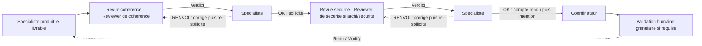

# Protocole — revue (reviewer)

Deux natures de revue coexistent dans le workflow, distinctes et non substituables.

> **Où se tient la revue : dans l'issue qui porte l'artefact revu — l'issue ADR quand il s'agit d'une ADR.** Une revue se tient **toujours sur l'issue qui porte l'artefact revu**, jamais sur une autre issue du flux. Sur impact structurant, l'artefact revu est l'**ADR** : les deux revues (cohérence puis sécurité) se tiennent donc **dans l'issue ADR dédiée** (l'issue parente de la décision créée au découpage — [`../stages/inception/deliverables-breakdown.md`](../stages/inception/deliverables-breakdown.md), Step 3.1), **et jamais dans l'issue d'origine** qui a déclenché le flux. La sollicitation se fait par mention A2A **sur l'issue ADR**, et les reviewers y postent leurs conclusions. Poster une revue d'ADR ailleurs que sur l'issue ADR est une **faute de flux** : la piste d'audit de la décision doit rester entière sur l'issue qui la porte. Hors impact structurant, la revue se tient sur l'issue qui porte le livrable concerné.

> **Qui peut solliciter une revue (source unique).** **Tout spécialiste ou architecte** peut solliciter une revue par mention A2A, pas uniquement le coordinateur — qui en reste le demandeur usuel au fil du stage. Les mentions « le coordinateur sollicite » des stages désignent le cas courant, elles ne restreignent pas ce droit. Reste au seul **coordinateur** ce qui relève de la coordination : passages de statut d'issue et fermeture de la boucle A2A. L'invariant de rôle est posé ci-dessous.

> **Séparation des rôles (non contournable).** L'**auteur d'un artefact n'en est jamais le relecteur**. Une revue (cohérence, sécurité ou autre) signée de l'auteur de l'artefact revu — pour une ADR, y compris via sa section `## Review` — est **nulle** : l'indépendance est perdue. Si une revue requise manque, elle est sollicitée auprès du reviewer dédié ; l'auteur ne la supplée jamais.

> **Le reviewer retourne toujours au spécialiste (pivot unique, non contournable).** Quel que soit son verdict — **OK comme RENVOI** —, un reviewer **mentionne toujours le spécialiste** (auteur du livrable revu) par lien de mention actif, et **jamais** un autre reviewer ni le coordinateur en remontée de verdict. Le spécialiste est le pivot : lui seul fait avancer l'artefact d'une revue à la suivante (sur OK) ou corrige puis re-sollicite le même reviewer (sur RENVOI). Enchaînement complet des stages : [`stage-protocol.md`](stage-protocol.md), « Cycle de livrable d'un spécialiste ».

## 1. Revue de cohérence (Reviewer de cohérence)

Portée : cohérence **documentation ↔ décisions structurantes**, absence de conflits entre décisions, complétude / structure / format des livrables.

- **Portée par une fonction « review-only » distincte** : le **Reviewer de cohérence** (persona `consistency-reviewer-agent`), sollicité par mention A2A (par le coordinateur ou tout spécialiste/architecte — voir « Qui peut solliciter une revue ») à réception d'un livrable d'un agent spécialiste (temps 5-6 du [`stage-protocol.md`](stage-protocol.md)). Sur impact structurant, cette sollicitation et le post de la revue se font **sur l'issue ADR dédiée** (voir l'encadré d'ouverture), jamais sur l'issue d'origine.
- Vérifie : correspondance documentation ↔ décisions, absence de décision structurante non tracée, absence d'artefact orphelin, respect des conventions (langue, diagrammes en code, aucun secret). Sur une DAS, vérifie aussi les conventions de la skill `architecture-solution-gabarits` : renvois vers l'architecture détaillée au **format d'ancre Structurizr** (`documentation/<Software System>#<ancre>`, **jamais** par chemin de fichier ; libellé = nom de section, pas de colonne « Fichier »), **pas de suffixe de nom de système** ni de préfixe dans les titres du détail, page `00` présente par dossier détaillé, et historique du `001` consolidé (une ligne = un livrable). Le sensor `detailed-arch-refs` (advisory) factualise les deux premiers points sans s'y substituer.
- **Analyse la longueur de prose du livrable** et **demande sa réduction lorsqu'elle ne nuit pas au contenu** (verbosité, redites, remplissage) ; le reviewer **précise dans son retour les éléments exacts à réduire** (section, paragraphe, tableau). Voir « Forme de la revue — prose réduite ».
- Verdict : **retour systématique au spécialiste** par lien de mention actif, OK comme RENVOI — jamais au reviewer de sécurité, au coordinateur ou à l'humain (voir l'encadré « Le reviewer retourne toujours au spécialiste »).
- **Classe** `review_class: advisory` ou `granular` selon le stage. La revue de cohérence **ne remplace jamais** le contrôle sécurité ni la validation humaine.

## 2. Revue de sécurité (Reviewer de sécurité) — obligatoire, non substituable

Portée : analyse des risques (OWASP / STRIDE toujours actifs ; NIST / COBIT si documentation des risques ; PCI DSS / GDPR / Loi 25 / LPRPDE **sur demande explicite uniquement**).

- **Portée par une fonction « review-only » distincte** : le **Reviewer de sécurité** (persona `security-reviewer-agent`).
- **Déclenchée systématiquement** dès qu'un stage produit ou modifie une architecture ou une **surface de sécurité** (instructions exécutables, frontières de délégation, contrôle de sécurité).
- Procédure : un demandeur (le coordinateur, ou tout spécialiste/architecte — voir « Qui peut solliciter une revue ») poste un commentaire mentionnant le **Reviewer de sécurité** (UUID résolu via `multica agent list --output json`) avec le contexte et le résumé des modifications ; **attend l'analyse** ; intègre les recommandations **avant** la validation humaine.
- Le Reviewer de sécurité **poste ses conclusions et recommandations directement dans la tâche qui porte l'artefact revu** — **l'issue ADR dédiée** sur impact structurant (voir l'encadré d'ouverture), l'issue du livrable sinon —, sans créer d'issue dédiée, puis **retourne son verdict au spécialiste** (OK comme RENVOI — voir l'encadré « Le reviewer retourne toujours au spécialiste »).
- **Plancher SG-3** : aucune revue de cohérence, aucun gate / sensor advisory ne peut porter, remplacer, conditionner ni court-circuiter la revue de sécurité. Un « vert » de gate ne dispense jamais de la revue de sécurité.

## Articulation des deux revues et du gate humain



- Les deux revues sont **séquentielles** (cohérence puis sécurité) et transitent par le spécialiste (encadré « Le reviewer retourne toujours au spécialiste »).
- La revue de cohérence **prépare** la revue de sécurité et le gate humain ; elle ne les remplace pas.
- La revue de sécurité **précède toujours** la validation humaine sur toute modification d'architecture.
- La **validation humaine granulaire** reste l'unique gate décisionnel contraignant (invariant).

## Forme de la revue — retour YAML sans prose (obligatoire)

> **Règle.** Tout retour de revue (cohérence, sécurité, ou tout autre reviewer du `core`) adressé à un agent est un **message A2A YAML joint** (`type: rapport-verification`, schéma : « Schéma du message A2A » de [`governance-security.md`](governance-security.md)). **Le verdict, les écarts et les vérifications sont portés par le YAML, jamais par de la prose dans le fil.** Le commentaire se limite à la **mention active du spécialiste + le nom du fichier YAML joint**. Une revue en prose Markdown (« Verdict : RENVOI », « Vérifié, sans écart »…) vers un agent est un **écart de flux A2A**.
>
> **Exception unique.** Une présentation destinée à l'**humain** (gate humaine) reste en Markdown détaillé — [`output-format.md`](output-format.md) et [`governance-security.md`](governance-security.md), « Deux formes de commentaire ».

Le message de revue suit le schéma A2A (`de`, `vers` = spécialiste auteur, `stage`, `objet`, `sensors_resultats`, `artefacts` consultés, `resultat`, `gate_humaine`, `reference_audit`) et porte en plus le bloc `revue` ci-dessous, propre au retour de reviewer :

```yaml
type: rapport-verification
de: <Reviewer de cohérence | Reviewer de sécurité | ...>
vers: <spécialiste auteur du livrable>
stage: <slug>
objet: "revue <cohérence|sécurité> de <artefact>"
revue:
  nature: coherence | securite
  verdict: ok | renvoi
  ecarts:                                  # vide si verdict ok
    - {id: E1, localisation: "<fichier § section / paragraphe>", motif: "<écart, norme OWASP/STRIDE le cas échéant>", correction: "<action attendue / condition de levée>", gravite: bloquant | mineur}
  reductions_prose:                        # éléments exacts à réduire, vide si aucun
    - {localisation: "<section / paragraphe / tableau>", motif: redite | remplissage | verbosite}
  verifications:                           # ce qui a été contrôlé
    - {controle: "<point vérifié>", resultat: conforme | ecart | non_verifie, detail: "<ligne factuelle>"}
  fichiers_modifies: []                    # toujours vide : un reviewer ne modifie rien
sensors_resultats: []                      # verdicts de sensor.py, jamais réinterprétés
resultat: {statut: ok | ecart}             # ok <=> verdict ok
gate_humaine: aucune
reference_audit: <id de commentaire ou d'artefact>
```

- Cohérence : `verdict: ok` ⇔ `ecarts` vide ⇔ `resultat.statut: ok`. Un écart bloquant impose `renvoi` / `ecart`.
- `localisation` et `motif` sont **obligatoires** pour chaque écart ; chaque écart reste compréhensible seul (aucun implicite). Les valeurs libres sont courtes, sans prose de remplissage, et **entre guillemets** si elles contiennent `:`, une virgule, `{` ou `}`.
- Le lien de mention reste **actif** et l'UUID résolu à chaque fois ; la réduction de prose ne touche jamais au lien.
- Si le téléversement de l'attachement échoue, appliquer le mode dégradé de la « Règle A2A » de [`governance-security.md`](governance-security.md) (YAML intégral dans un unique bloc ```` ```yaml ````) ; jamais de prose de verdict hors du YAML.

### Réduction du contenu

> La réduction ci-dessous s'applique aux **valeurs** du YAML ; elle décline, pour la revue, l'exigence commune de [`output-format.md`](output-format.md). La revue n'a pas la structure en 4 sections (`## Résumé` / `## Sensors` / …) : son verdict YAML prime.

S'applique à **toute revue** (cohérence comme sécurité), sur n'importe quel verdict (OK comme RENVOI) :

- Le reviewer **doit réduire la prose** des valeurs de son YAML : formulations courtes, une idée par entrée, aucun remplissage, aucune reformulation de ce qui est déjà tracé. La réduction se fait **sans perte de contexte** — chaque écart, risque ou recommandation reste **intégralement compréhensible** et actionnable de façon autonome par le spécialiste, sans que celui-ci ait à reconstituer l'implicite.
- **Structure plutôt que tableaux** : les listes d'écarts et de vérifications sont des listes YAML à champs fixes ; aucun tableau Markdown dans un retour de revue à un agent.
- Objectif : un retour **dense et sans ambiguïté**. La concision ne justifie jamais d'omettre un écart, une référence de norme (OWASP / STRIDE…) ou une condition de levée d'un RENVOI.
- **Qui applique la réduction.** Le reviewer rédige lui-même sa revue en prose réduite — c'est **sa propre production**, pas une modification du livrable. L'invariant de séparation des rôles reste entier : le reviewer **ne réécrit jamais** la prose de l'artefact de l'auteur ; s'il juge la prose du livrable trop verbeuse, il **le signale comme écart** (RENVOI / demande de correction) et c'est le **spécialiste auteur** qui corrige.
- **Analyse de la prose du livrable (obligatoire).** Le reviewer **évalue la longueur de la prose** du livrable revu et **demande sa réduction dès qu'elle peut l'être sans nuire au contenu** (sans perte d'information, de nuance ni de traçabilité). Sa demande est **précise et localisée** : il **énumère dans `revue.reductions_prose` les éléments exacts à réduire** (section / paragraphe / puce / tableau visés) avec, pour chacun, le motif (redite, remplissage, verbosité) — jamais une injonction vague « réduire la prose ». Si la longueur est justifiée par le contenu, il **ne demande aucune réduction**.

## Fin de revue

Une revue n'est jamais close sans un **retour A2A par lien de mention actif vers le spécialiste** (auteur du livrable revu) — jamais directement vers un autre reviewer, le coordinateur ou l'humain (encadré « Le reviewer retourne toujours au spécialiste »). Les conclusions (verdict OK / RENVOI, écarts, éléments à réduire, vérifications, condition de levée) voyagent **exclusivement** dans le YAML `rapport-verification` joint à l'issue ; le commentaire est réduit à la mention active + le nom du fichier joint. Les mécanismes de ce retour (passage de statut, lien actif posé par l'agent lui-même, vérification `trigger_outcomes`, anti-wake parasite) sont définis **une seule fois** dans la « Checklist de sortie de stage » de [`stage-protocol.md`](stage-protocol.md) et la « Règle A2A » / « Schéma du message A2A » de [`governance-security.md`](governance-security.md) — non redéfinis ici.
