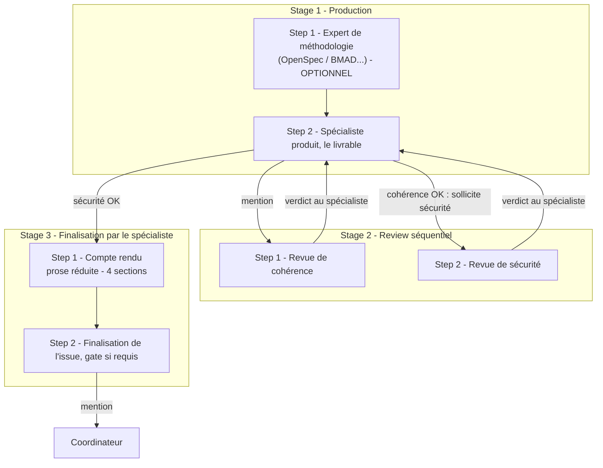
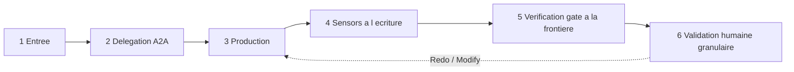

# Protocole — exécution générique d'un stage

Cycle standard qu'un stage suit, quel que soit sa phase. Il ne se substitue jamais aux instructions propres de la fiche de stage ; il en fixe l'ossature commune, adaptée au moteur A2A Multica (mentions UUID, statut d'issue, piste d'audit sur l'issue).

## Cycle de livrable d'un spécialiste — 3 stages (cadre macro)

Tout livrable confié à un spécialiste (architecte ou expert de domaine) suit **trois stages**, le **spécialiste étant le pivot unique** qui fait avancer son artefact d'un stage/step au suivant par mention A2A. Ce cadre macro structure la production d'un livrable ; le « Cycle en 6 temps » ci-dessous reste la mécanique interne d'exécution d'un stage délégué.



- **Stage 1 — Production.**
  - *Step 1 (optionnel)* : l'**Expert de méthodologie** (OpenSpec, BMAD, etc.) intervient **selon la méthodologie activée** ; **sauté** s'il n'y a pas de méthodologie explicite.
  - *Step 2* : le **spécialiste** produit le livrable. En fin de stage, il mentionne le **Reviewer de cohérence** puis **termine son tour** (il n'attend pas la revue dans son run) ; aucun lien actif vers le coordinateur (encadré « Fenêtre de pose » ci-dessous) — c'est le **verdict du reviewer** qui le réveille.
- **Stage 2 — Review (séquentiel).** Les deux revues transitent **toutes par le spécialiste** (voir [`reviewer.md`](reviewer.md), encadré « Le reviewer retourne toujours au spécialiste »).
  - *Step 1 — Revue de cohérence* : le reviewer mentionne le spécialiste. **OK** ⇒ le spécialiste enchaîne le Step 2 (sollicite le reviewer de sécurité). **RENVOI** ⇒ le spécialiste corrige puis re-sollicite le reviewer de cohérence.
  - *Step 2 — Revue de sécurité* : le reviewer mentionne le spécialiste. **OK** ⇒ le spécialiste passe au Stage 3. **RENVOI** ⇒ le spécialiste corrige puis re-sollicite le reviewer de sécurité.
- **Stage 3 — Finalisation (par le spécialiste).**
  - *Step 1* : compte rendu en **prose réduite et 4 sections** (`## Résumé` · `## Sensors` *(si sensors déclarés dans le stage)* · `## Points bloquants` *(si blocage)* · `## Action humaine requise` *(uniquement si l'humain doit intervenir, avec mention humaine active — jamais sur un retour A2A vers un agent)*) — forme imposée par [`output-format.md`](output-format.md), source unique.
  - *Step 2* : finalisation de l'issue (gate humain si requis), puis mention du coordinateur (lien de retour actif).

> **Fenêtre de pose du lien de retour vers le coordinateur (invariant, durcissement anti-wake parasite).** Un spécialiste (auteur du livrable) ne pose un **lien de mention actif** vers le coordinateur (`[@<Nom coordinateur>](mention://agent/<uuid>)`) qu'au **Stage 3**, une fois le **portail de revues du Stage 2 clos** — tous les verdicts requis au vert (cohérence puis sécurité) et réserves intégrées. Pendant les **Stages 1 et 2**, le coordinateur est désigné **en texte clair uniquement** (« reviens vers moi, Architecture Solution & Intégration »), **jamais par un lien actif**. Un lien actif vers le coordinateur posé **avant** la clôture des revues est un **réveil parasite** et constitue un **écart de flux A2A** (observé sur ORIG-176 et ORIG-177, où le commentaire de mise en revue réveillait prématurément le coordinateur). Cette fenêtre **prolonge** la règle « anti-wake parasite » (aucune auto-mention active ; lien de retour posé par l'agent délégataire, UUID résolu dynamiquement — voir [`governance-security.md`](governance-security.md), « Règle A2A ») : elle fixe le ***quand*** du lien de retour, sans en relâcher aucune autre condition.

> **Décision structurante : ADR d'abord (garde-fou inchangé).** Sur impact **structurant**, le flux **ADR d'abord** s'applique en premier (ADR produite → revue de cohérence → revue de sécurité → `ADR Proposée` → gate humaine — voir [`../stages/inception/design-and-decisions.md`](../stages/inception/design-and-decisions.md), « Flux ADR — impact structurant = Oui », et l'orchestration des issues dans [`../stages/inception/deliverables-breakdown.md`](../stages/inception/deliverables-breakdown.md)). Les livrables aval ne suivent le présent cycle à 3 stages qu'**après acceptation de l'ADR**.

## Cycle en 6 temps



### 1. Entrée — pré-requis et contexte
- Vérifier que les `requires_stage` sont satisfaits et que les artefacts `consumes` (marqués `required: true`) existent. Sinon : **halt-and-ask** (ne jamais deviner).
- Charger, **à la demande**, uniquement le contexte nécessaire au stage (chargement optimisé — voir `conductor.md`).
- **À réception d'une délégation, le délégataire recharge sa fiche de stage (le *quoi* de son étape) et les protocoles qu'elle cite** — ceux listés dans le message A2A `delegation` —, rien d'autre. Chargement ciblé et paresseux ; ne pas relire le workflow en entier. Le message porte aussi `core_home` (racine du checkout `homelab-portfolio`) pour lancer sensors, gates et hook sans re-chercher le harnais.

### 2. Délégation A2A (si `mode: subagent | pipeline | mob`)
- Le coordinateur **téléverse un fichier YAML (message A2A, type `delegation`)** via `multica attachment`, puis poste un **commentaire minimal** : une **mention valide** `[@Label](mention://agent/<uuid>)` + le **nom du fichier joint**, sans prose de mission. Le YAML joint porte la **mission claire** : objectif, périmètre, critères d'acceptation et **`sensors_a_executer`** (la liste des sensors que l'agent délégataire devra lancer, reprise du champ `sensors:` de la fiche de stage), ainsi que **`core_home`** (racine du checkout du harnais) et la **fiche de stage + protocoles à recharger** (temps 1). La mission est **autosuffisante** : l'agent délégataire démarre sans le contexte du coordinateur, le YAML **reporte donc explicitement les décisions amont** qui cadrent le livrable (option retenue, contraintes, exclusions, dépendances) — en particulier, sur impact structurant, les directives tirées de l'**ADR acceptée** (voir [`../stages/inception/deliverables-breakdown.md`](../stages/inception/deliverables-breakdown.md), « Mission déléguée — contenu obligatoire »). Le coordinateur **nomme en texte clair** l'agent vers qui revenir en fin de tâche (lui-même, « reviens vers moi, Architecture Solution & Intégration ») **sans poser de lien de mention actif vers lui-même** (anti-wake parasite — voir [`governance-security.md`](governance-security.md), « Règle A2A »). La **pose du lien de retour actif revient à l'agent délégataire** (temps 3 + checklist de sortie). Schéma du message A2A : source unique dans [`governance-security.md`](governance-security.md), « Schéma du message A2A ».
- **Tag de méthodologie (contexte Multica uniquement)** : lorsque la mission relève d'une méthodologie activée **et que l'on opère sous Multica**, l'issue déléguée porte le label correspondant — en particulier, toute issue confiée à l'**OpenSpec Expert** est taguée **`OpenSpec`** (`multica issue label add <issue-id> <label-id>`, l'id du label résolu via `multica label list --output json` ; créer le label via `multica label create` s'il n'existe pas). Les labels d'issue étant **propres à Multica**, cette étape n'a aucun sens hors Multica et est alors sautée. Le tag est posé par le premier des deux qui agit — le coordinateur à la délégation **ou** l'OpenSpec Expert en première action (idempotent). Voir `deliverables-breakdown.md`, `conductor.md` et [`openspec-agent.md`](../../agents/openspec-agent.md).
- **Ne jamais deviner un UUID** : le résoudre via `multica agent list --output json` (champ `id`). Vérifier `trigger_outcomes` après chaque mention.
- La **topologie** dépend du `mode` (voir [`stage-definition.md`](stage-definition.md)) : `subagent` = hub-and-spoke (chaque support en rayon aveugle) ; `pipeline` = supports chaînés dans l'ordre déclaré ; `mob` = supports en parallèle contre le brouillon du lead, une ronde d'objection bornée. `pipeline` / `mob` exigent `support_agents` non vide.
- Si `mode: inline`, le coordinateur (ou l'agent porteur) exécute directement (supports = voix adoptées).
- Si `for_each` est déclaré, le cycle 3→6 s'exécute **une fois par instance** de l'artefact nommé.

### 3. Production
- La fonction `lead_agent` produit les artefacts `produces`, dans la langue de l'humain, sans secret, diagrammes en code à syntaxe validée.
- Chaque décision structurante est tracée dans le registre de décisions du projet.
- L'agent trace son avancement sur l'issue (piste d'audit au fil de l'eau).

> ⛔ **UN STAGE DÉLÉGUÉ N'EST JAMAIS TERMINÉ SANS LIEN DE RETOUR ACTIF.** Produire le livrable ne suffit pas : tant que le lien de mention actif vers l'assigneur n'est pas posé, le coordinateur n'est pas prévenu et la chaîne A2A reste rompue (c'est l'écart constaté sur ORIG-62 / ORIG-63 : le travail livré, mais le coordinateur jamais réveillé).

- **Retour de délégation (obligatoire, à la charge de l'agent délégataire)** : en fin de production, l'agent `lead_agent` passe l'issue en `in_review`, **téléverse un fichier YAML (message A2A, type `retour`)** portant `resultat` + **`sensors_resultats`** (les verdicts rendus par `sensor.py` pour chaque sensor de `sensors_a_executer`) + la liste des `artefacts` produits, puis poste un **commentaire minimal** clos par le lien de mention actif `[@<Nom de l'assigneur>](mention://agent/<uuid-assigneur>)` vers **l'agent qui l'a délégué** (le coordinateur) + le **nom du fichier YAML de retour joint** — sans prose de livrable ni rapport de sensors dans le fil. L'UUID est **résolu à chaque fois** via `multica agent list --output json` (à partir du **nom** de l'assigneur donné en texte clair dans la mission), **jamais copié depuis la consigne de délégation ni codé en dur**. C'est **ce lien, posé par l'agent qui termine, qui enqueue le run de reprise du coordinateur** ; une mention en texte clair ou une simple réponse dans le fil **n'enqueue aucun run**. Réciproquement, **aucun agent ne se mentionne lui-même** avec un lien actif (anti-wake parasite — voir [`governance-security.md`](governance-security.md), « Règle A2A »).
- **Vérification `trigger_outcomes`** : après le post, l'agent vérifie les `trigger_outcomes` de son commentaire. Si la mention n'a pas déclenché le run attendu (`blocked` / `coalesced` / `deferred`), il le signale sur l'issue (halt-and-ask) plutôt que de considérer la tâche terminée.

### 4. Sensors à l'écriture

> ⛔ **Les sensors ne se contournent pas.** Une vérification équivalente faite en prose, un commentaire ad hoc, ou une affirmation « conforme » sans rapport de sensor **ne satisfont pas** le temps 4. L'absence de rapport de sensor pour un sensor déclaré est un **écart à signaler** (SG-2 : indisponible ≠ conforme, silence = écart).

Pour chaque artefact produit ou modifié, l'agent **auteur** exécute, à l'écriture, **tous les sensors déclarés dans le champ `sensors:` de la fiche de stage** (ceux listés dans `sensors_a_executer` du message A2A de délégation) avec `python3 "$CORE_HOME/core/scripts/sensor.py" --root <projet> fire <id> --path <artefact>` (les sensors `fire_on: gate` : sans `--path`, au gate). Le verdict est celui du script (`sensor.py`), jamais réinterprété.

> **Où se lance un sensor (convention d'invocation).** Le harnais (`core/scripts/sensor.py`, les manifestes `core/sensors/` et le hook `core/sensors/hooks/post_write.py`) vit dans le **checkout `homelab-portfolio`** (le dépôt `core`), **jamais** dans le dépôt du projet vérifié. Les sensors se lancent **depuis ce checkout** : le script est désigné par un **chemin ancré** sur sa racine — `$CORE_HOME` = racine du checkout `homelab-portfolio` — et `--root <projet>` pointe le dépôt du projet à vérifier. Un chemin **relatif** (`core/scripts/sensor.py`) ne se résout que si le répertoire courant est déjà ce checkout ; lancé depuis le dossier du projet, il échoue en « script introuvable » (origine ORIG-425/ORIG-426). Toute commande de sensor de ce protocole suppose `$CORE_HOME` défini et pointant le checkout `core`. Le **support de restitution dépend du destinataire** :

- **Handoff A2A pur (agent → agent, sans gate humaine)** : les verdicts sont portés par le champ **`sensors_resultats`** du message A2A de `retour` joint à l'issue (une entrée par sensor : `{sensor, verdict: conforme | ecart | indisponible, detail, source}`), **pas en prose dans le fil**. Schéma : source unique dans [`governance-security.md`](governance-security.md).
- **Gate humaine (OBLIGATOIRE)** : à **tout gate de validation humaine**, les verdicts de sensors **DOIVENT être présentés à l'humain en clair** dans la section `## Sensors` du compte rendu, au format imposé par [`output-format.md`](output-format.md) (une puce par sensor, `✅ conforme | ⚠️ écart mineur — <une ligne> | ⛔ indisponible — <motif>`). C'est une **information de décision destinée à l'humain**, jamais réduite ni masquée : le YAML joint ne s'y substitue **jamais**. Un gate humain présenté **sans** les sensors du stage est un **écart** (SG-2 : silence = écart ; contrôle coordinateur au gate ci-dessous). La réduction de prose A2A ne retire **rien** de ce que l'humain voit au gate.

Règles non contournables :

- **Chaque sensor déclaré figure distinctement** — en entrée `sensors_resultats` (A2A) et/ou en puce `## Sensors` (gate humaine) — **aucun regroupement ni omission**. Un sensor déclaré mais absent de la restitution = **écart**.
- **`⛔ indisponible` / `indisponible`** s'applique lorsque le script ne peut pas s'exécuter (Python absent, erreur, périmètre vide — voir `sensors/README.md`) : l'agent reprend le motif donné par le script et le reporte avec ce verdict. Un sensor non exécuté est toujours un verdict `indisponible`, **jamais un silence** ni une vérification en prose. Le verdict reporté est celui du script, jamais réinterprété.
- **`⚠️ écart` / `ecart`** : l'agent décrit l'écart et continue (advisory) ; il **ne devance pas** la décision humaine mais la documente pour la validation humaine granulaire (temps 6).
- Le rapport est **advisory** — n'autorise aucun raccourci, ne vaut pas validation (SG-1..6).
- Les sensors `fire_on: write` (ex. `diagram-validity`, `detailed-arch-refs`) sont invoqués **à chaque écriture** de l'artefact concerné, pas seulement en fin de stage.

### 5. Verification gate à la frontière de phase

> ⛔ **Le rapport de gate ne se contourne pas.** Le coordinateur **poste le rapport de vérification** ([`core/sensors/gates.md`](../../sensors/gates.md)) *avant* la validation humaine, avec `python3 "$CORE_HOME/core/scripts/sensor.py" --root <projet> gate <id-frontière>` (lancé depuis le checkout `core` — voir la convention d'invocation ci-dessus). L'absence de rapport est un écart de piste d'audit.

Le coordinateur exécute le gate de traçabilité et poste le **« Rapport de vérification »** structuré pour la frontière franchie :

```
**Rapport de vérification — <id-frontière>** (`<Frontière : Phase A → Phase B>`)
Checks : artefacts-présents ✅/⚠️/⛔ | liaison-traçabilité ✅/⚠️/⛔ | absence-orphelin ✅/⚠️/⛔
Sensors de gate :
- `<sensor-id>` : ✅/⚠️/⛔ <fait ou motif>
```

Un écart est signalé, jamais bloquant ; `⛔ indisponible ≠ conforme` (SG-2).

> ⛔ **Contrôle du compte rendu au gate** Au même point — **avant la validation humaine** — le coordinateur contrôle que le **compte rendu de l'agent auteur porte une section `## Sensors` renseignée** dès lors que la **fiche de stage active déclare un champ `sensors:` non vide**. Un compte rendu sans section `## Sensors` (ou avec une section vide) alors que le stage déclare des sensors est un **écart à signaler** (SG-2 : indisponible ≠ conforme, silence = écart) : il rend visible un temps 4 non rejoué, même si l'agent auteur a omis de lancer `fire`. Exécution :
>
> ```
> python3 "$CORE_HOME/core/scripts/sensor.py" report-check --stage <fiche-de-stage-active> --report-file <compte-rendu>
> ```
>
> (ou le compte rendu sur stdin). Le contrôle est **advisory** — code retour 0 même en écart, il **ne bloque jamais** la validation humaine ; le coordinateur **signale** l'écart dans le Rapport de vérification et **propose de faire rejouer le temps 4** avant de présenter le contenu à l'humain. Si la fiche de stage déclare `sensors: []` (ou aucun champ), l'absence de section `## Sensors` est **légitime** et le contrôle renvoie `✅`. Rendre ce contrôle **bloquant** serait une décision structurante distincte (ADR + contrôle sécurité, SG-3).

### 6. Validation humaine granulaire
- Selon `human_gate` : `none` (aucune — Initialization), `light` (approbation intention/périmètre — Ideation), `granular` (choix par choix — Inception / Construction), `explicit` (validation explicite + rollback si destructif — Operation).
- Boucle **Keep / Modify / Redo** par élément (voir `conductor.md`). Sur `Modify` / `Redo`, retour au temps 3 pour l'élément concerné uniquement.

## Contrôle sécurité — non contournable
Dès qu'un stage **produit ou modifie une architecture** (ou une surface de sécurité), le coordinateur sollicite le **Reviewer de sécurité** **avant** la validation humaine et intègre ses recommandations. L'autonomie (Construction) ne court-circuite ni ne diffère jamais ce contrôle. Voir [`governance-security.md`](governance-security.md) et [`reviewer.md`](reviewer.md).

## Checklist de sortie de stage (`mode: subagent | pipeline | mob`) — non contournable
Un stage délégué n'est considéré **terminé** QUE lorsque les trois cases sont cochées, **dans cet ordre** — c'est le **point de passage unique** que tout agent délégué franchit, quelle que soit sa fonction :

1. ☑ **Livrable produit, sensors rapportés, et contrôlé** — artefacts `produces` écrits, **verdicts de sensors rapportés pour chaque sensor déclaré** (aucun ne peut être omis ni remplacé par une vérification en prose), décision structurante tracée, piste d'audit posée sur l'issue. **Le support de restitution dépend du destinataire** (source unique : [`governance-security.md`](governance-security.md), « Deux formes de commentaire ») :
   - **Handoff A2A pur (vers un agent)** : mission / livrable / verdicts de sensors portés par le **fichier YAML joint (message A2A)** — `resultat` + `sensors_resultats` — ; le commentaire est réduit à la mention active + le nom du fichier joint, **sans prose ni section `## Sensors`** dans le fil.
   - **Commentaire destiné à l'humain (gate, présentation)** : rédigé en **prose réduite et 4 sections** (`## Résumé` ; `## Sensors` si sensors déclarés ; `## Points bloquants` si blocage ; `## Action humaine requise` **uniquement si l'humain doit réellement intervenir**, et alors **toujours** avec un lien de mention actif de l'humain) — forme imposée par [`output-format.md`](output-format.md) (source unique), sans affaiblir aucune norme de gating.
   **Un retour A2A vers un agent (coordinateur, spécialiste) n'est pas une sollicitation humaine : il ne porte jamais la section « Action humaine requise » ni de mention de l'humain** (voir `output-format.md`, § `## Action humaine requise`, et [`governance-security.md`](governance-security.md), « Réciproque (exclusivité) »).
2. ☑ **Issue en `in_review` + lien de retour ACTIF posé** — le commentaire de retour se termine par `[@<Nom assigneur>](mention://agent/<uuid>)`, UUID résolu via `multica agent list --output json` (jamais copié / codé en dur), jamais une auto-mention. C'est ce lien qui enqueue le run de reprise. **Cible du retour** : le coordinateur pour un agent de production délégué ; le **spécialiste** (auteur du livrable) pour un **reviewer** — jamais un autre reviewer ni le coordinateur (voir [`reviewer.md`](reviewer.md), encadré « Le reviewer retourne toujours au spécialiste »). **Fenêtre de pose** : pour un spécialiste, le lien actif vers le **coordinateur** ne se pose qu'au **Stage 3**, portail de revues du Stage 2 clos — jamais à la mise en revue des Stages 1-2 (voir l'encadré « Fenêtre de pose du lien de retour vers le coordinateur » ci-dessus) ; pendant les revues, le spécialiste met l'issue en `in_review` et sollicite le reviewer suivant **sans** poser de lien actif vers le coordinateur.
3. ☑ **`trigger_outcomes` vérifié** — la mention a bien déclenché le run attendu ; sinon (`blocked` / `coalesced` / `deferred`) → **halt-and-ask** sur l'issue, ne pas conclure.

Tant que 2 ou 3 manque, la tâche est **incomplète** : ne jamais rendre la main comme si le stage était clos. Cette checklist est l'**unique endroit non contournable** de l'obligation de retour A2A ; les fiches d'agent ne la répètent pas, elles s'y réfèrent.

## Halt-and-ask
Le cycle s'arrête et interroge l'humain dès : échec / impossibilité d'un livrable ; écart ou contrôle de sécurité requis ; gate / sensor en écart ou `⛔ indisponible` ; décision structurante nouvelle non cadrée ; action à impact / destructive (jamais autonome).

**Mention humaine obligatoire (quel que soit l'agent)** : tout `halt-and-ask` — comme toute autre action humaine requise — exige de mentionner l'humain. L'agent qui le déclenche — coordinateur ou agent délégué, sans exception — **doit TOUJOURS mentionner explicitement l'humain demandeur** sur l'issue avec un lien de mention actif (`[@Nom](mention://member/<user_id>)`, UUID résolu via `multica workspace member list --output json`), décrire l'action attendue et l'arbitrage, et passer l'issue en `blocked` lorsque le workflow ne peut pas avancer. Un commentaire sans mention humaine valide (texte clair ou placeholder) ne satisfait pas cette obligation. L'agent n'avance pas et ne devine pas tant que l'humain n'a pas tranché. Invariant non contournable — voir la clause « Mention humaine obligatoire dès qu'une action humaine est requise » de [`governance-security.md`](governance-security.md).
