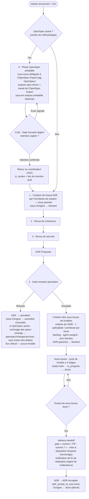

# Planification et découpage en livrables

## Objectif

Découper le travail en livrables et désigner l'agent responsable de chacun.

> **Style du livrable.** Tout document produit par ce stage suit le style concis (information strictement nécessaire, puces multi-niveaux, texte aéré ; tableaux des gabarits conservés) — source unique [`document-style`](../../protocols/document-style.md) (règle `RULE-WS-007`).

## Steps

### Step 1 — Déterminer phases, étapes et profondeur

### Step 2 — Découper et désigner l'agent responsable

Le coordinateur **identifie la nature de chaque travail** (architecture solution / logicielle, infrastructure, sécurité, données, AWS, Azure…) et effectue **une délégation par spécialiste concerné**.

- Un même lot peut relever de plusieurs natures, donc de plusieurs délégations parallèles.
- Cela vaut aussi pour les travaux issus d'une passation amont (ex. passation remontée par l'OpenSpec Expert après approbation d'une spécification).

Répartition :

- **Architecte de solution** : documentation d'architecture, décisions structurantes, patrons d'architecture, diagrammes.
- **Architecte de données** : modélisation, gouvernance, classification, cycle de vie (`10-cycle_vie_donnees.md`).
  - Délégué par l'Architecte de solution, qui valide le livrable (critère : sensor `data-lifecycle`).
- **Architecte AWS** (si AWS requis) : choix, diagrammes, coûts.
- **Architecte Azure** (si Azure requis) : choix, diagrammes, coûts, livrables d'infrastructure de déploiement (IaC, plans de déploiement / rollback).
- **Infrastructure Windows** (si concerné) : postes, VM, migration Win10→Win11, Intune, Autopilot, SCCM.
  - Périmètre strictement Windows ; le cloud Azure relève de l'Architecte Azure.
- **Architecte Cybersécurité** (si une surface de sécurité est produite ou modifiée) : menaces, conformité (OWASP, STRIDE, ISO 27001, NIST…).
  - Le livrable couvre l'**analyse de sécurité ET la mise à jour de la documentation d'architecture de sécurité** (`documentation/architecture-securite/`).
  - Même règle qu'à l'émergence en cours de production ([`detailed-deliverables`](../construction/detailed-deliverables.md), Step 1.1).
- **OpenSpec Expert** (uniquement si OpenSpec activé) : cycle spec-driven.

> **Pré-requis — verdict de méthodologie.**
> - Toute condition « si OpenSpec activé » de ce stage (Step 3.0, Steps 3.3 et 4, délégation à l'OpenSpec Expert) s'appuie sur le **verdict de méthodologie** tracé au cadrage ([`intake-framing`](intake-framing.md), Step 3 ; règle « Activation conditionnelle d'une méthodologie » de [`conductor`](../../conductor.md)).
> - Le coordinateur **lit ce verdict** avant de découper.
> - Verdict absent ou ambigu ⇒ **halt-and-ask** : faire statuer l'humain, puis l'inscrire dans la description du projet. Ne jamais traiter OpenSpec comme inactif par défaut.
> - Même principe pour toute autre méthodologie déclarée.

### Step 3 — Flux impact structurant (ADR d'abord, livrables en sous-issues)

Verdict d'impact structurant = **`Oui`** ([`intake-framing`](intake-framing.md), Step 5) ⇒ l'ordre est **inversé** : **rien n'est créé avant l'ADR**.

- L'**issue ADR** est créée en premier ; elle devient l'**issue parente** de la décision.
- Les livrables n'existent qu'**après acceptation humaine**, en **sous-issues (enfants)** de l'ADR.
- Plusieurs décisions structurantes ⇒ ce flux s'applique **une fois par ADR**.
- Doute sur le verdict ⇒ halt-and-ask.

> **Phase OpenSpec préalable — conditionnelle, toujours en amont de l'ADR.**
> - OpenSpec activé ⇒ une phase OpenSpec précède la création de l'issue ADR (Step 3.0).
> - L'analyse est réalisée par l'**OpenSpec Expert** dans son cycle spec-driven : aucune analyse préalable distincte n'est menée par le coordinateur ou un architecte.
> - Elle est close par une **gate humaine légère** (`human_gate: light`) de confirmation d'intention, **avant** tout retour au coordinateur.
> - Ensuite seulement, le coordinateur lance le flux ADR (Step 3.1).
> - OpenSpec non activé ⇒ le flux démarre directement à la création de l'issue ADR, sans gate légère.
> - La phase OpenSpec ne remplace jamais l'ADR ni sa gate **granulaire** (Step 3.4) : la gate légère porte sur l'intention OpenSpec, la gate granulaire sur la décision ADR.

#### Step 3.0 — Phase OpenSpec préalable (conditionnelle : uniquement si OpenSpec activé)

OpenSpec non activé ⇒ step **sauté** : passer au Step 3.1.

OpenSpec activé (verdict tracé au cadrage ; absent ou ambigu ⇒ halt-and-ask, voir le pré-requis du Step 2) ⇒ le coordinateur crée **d'abord**, avant l'issue ADR, une **sous-issue OpenSpec** déléguée à l'OpenSpec Expert et taguée `OpenSpec` (voir « Mission déléguée », tag de méthodologie).

- **L'analyse est le travail de l'OpenSpec Expert** :
  - Il la réalise dans son cycle spec-driven (proposal / design / deltas EARS).
  - Le coordinateur ne la produit pas.
- **Gate humaine légère (`human_gate: light`) — avant tout retour au coordinateur** :
  - L'humain confirme que l'analyse reflète fidèlement le besoin exprimé (Keep / Modify / Redo), comme au gate léger d'Ideation ([`intent-scope-approval`](../ideation/intent-scope-approval.md)).
  - Elle ne remplace jamais la gate granulaire de l'ADR (Step 3.4).
  - Tant que l'humain n'a pas confirmé, l'OpenSpec Expert ne retourne pas au coordinateur.
  - Écart signalé ⇒ analyse ajustée, puis re-soumise à la même gate.
- **Retour au coordinateur — seulement après validation légère** :
  - Retour A2A (`in_review` + lien de mention actif) selon la « Checklist de sortie de stage » ([`stage-protocol`](../../protocols/stage-protocol.md)).
  - Le coordinateur lance alors le flux ADR (Step 3.1).

> **Ordre invariant : OpenSpec (le cas échéant) → ADR, jamais l'inverse.** L'ADR reste obligatoire et non contournable ; la phase OpenSpec la précède, ne la remplace pas.

#### Step 3.1 — Créer l'issue ADR (parente), déléguée à l'Architecte de solution

Le coordinateur crée l'issue ADR, déléguée à l'**Architecte de solution**. Celui-ci la conduit au stage [`design-and-decisions`](design-and-decisions.md) (production, revues cohérence puis sécurité, `ADR Proposée`, décision humaine).

Garde-fou non contournable ([`conductor`](../../conductor.md), « Garde-fous ») : un impact structurant ne peut jamais être traité sans issue ADR.

> **L'issue d'origine est bloquée dès la création de l'issue ADR.**
> - L'issue ADR est une sous-issue de l'issue d'origine (celle que l'humain a ajoutée).
> - Dès qu'il crée et lance l'issue ADR, le coordinateur passe l'**issue d'origine en `blocked`**.
> - Son déblocage est **dérivé** : refus (Step 3.2) ou clôture (Step 3.4).
> - Garde-fou « Issue parente bloquée tant que ses sous-issues ne sont pas terminées » ([`conductor`](../../conductor.md)).

> **Tout le cycle de revue se déroule sur l'issue ADR**, jamais sur l'issue d'origine ([`design-and-decisions`](design-and-decisions.md), « Flux ADR » ; [`reviewer`](../../protocols/reviewer.md)).

#### Step 3.2 — Gate humaine : accepter ou refuser

- **ADR acceptée (Keep)** ⇒ le coordinateur crée puis lance les sous-issues de livrable (Step 3.3).
- **ADR refusée** :
  - L'issue ADR passe à `cancelled` ; aucun livrable n'est créé.
  - L'issue d'origine est **annulée en cascade** (`cancelled`) : un refus ne la laisse jamais ouverte ni bloquée.
  - Si OpenSpec était activé (phase du Step 3.0) : le coordinateur sollicite l'OpenSpec Expert pour **archiver les spécifications** de cette phase.
    - Le change est déplacé vers `openspec/changes/archive/AAAA-MM-JJ-<nom>/`.
    - **Archivage de change abandonné, SANS fusion des deltas** dans les specs vivantes (`openspec/specs/<capability>/spec.md`) : rien n'est déployé.
    - Différence avec l'archivage post-déploiement, qui fusionne les deltas ([`deployment-under-validation`](../operation/deployment-under-validation.md), Step 5).
  - Si l'humain reformule la décision : **nouvelle** issue d'origine et nouvelle issue ADR.

#### Step 3.3 — Sous-issues de livrable, créées seulement après acceptation (enfants de l'ADR)

Pour chaque délégation, le coordinateur :

- crée une **sous-issue** rattachée à l'ADR, en `backlog`, avec son **agent délégataire assigné** (identifiant résolu, jamais deviné) ;
- la **lance** (`todo`, ce qui démarre l'agent) avec mention A2A ;
- une fois **toutes** les sous-issues créées et lancées, passe l'**issue ADR en `blocked`** : elle le reste tant qu'elles ne sont pas toutes terminées (déblocage dérivé : Step 3.4).

Règle « une sous-issue par agent » : voir plus bas.

> **Directives complètes, dérivées de l'ADR acceptée.**
> - L'agent délégataire démarre « à froid » : il ne voit ni le fil de l'ADR ni le contexte du coordinateur.
> - Chaque sous-issue est donc **autosuffisante** et reporte les décisions de l'ADR qui conditionnent le livrable (`decisions/<NNNN>-<titre>.md`).
> - Contenu requis : [« Mission déléguée — contenu obligatoire »](#mission-déléguée--contenu-obligatoire).
> - Information manquante dans l'ADR ⇒ halt-and-ask, jamais deviner.

> **Cycle de livrable à 3 stages.**
> - Toute sous-issue lancée suit le cycle d'un livrable de spécialiste : Production (expert de méthodologie optionnel, puis spécialiste) → Review (cohérence puis sécurité, via le spécialiste) → Finalisation (compte rendu, clôture).
> - Source unique : [`stage-protocol`](../../protocols/stage-protocol.md), « Cycle de livrable d'un spécialiste ».
> - `todo → in_progress → done` n'est que le reflet de statut de ce cycle, jamais un raccourci.

**Uniquement si OpenSpec activé** : ajouter une sous-issue dédiée au cycle spec-driven (création / modification / suppression de spécifications), déléguée à l'OpenSpec Expert.

#### Step 3.4 — Mise à disposition puis clôture de l'ADR quand tous les livrables sont terminés

L'issue ADR reste `blocked` (parente) tant que ses sous-issues tournent.

Toutes les sous-issues `done` ⇒ livrables réalisés, revus et validés. Le coordinateur **ne clôt pas directement l'ADR** : il les achemine d'abord vers [`delivery-handoff`](../construction/delivery-handoff.md), source unique de la mise à disposition :

- gate humain systématique « commit + PR : oui ou non ? » (Step 1) ;
- mise à disposition par l'Experte d'archivage (commit + PR si accord explicite, sinon archivage par dossier — Steps 2-3) ;
- notification de fin de réalisation par l'Agent de notifications (Step 4).

Une fois `delivery-handoff` effectué (mise à disposition faite, notification envoyée) :

- Le coordinateur passe l'issue ADR à **`ADR Acceptée`** (`adr_accept_e`, catégorie `done`).
  - Clôture dérivée, sans acte humain au-delà du gate PR.
  - Le statut marque une ADR acceptée et menée à terme.
- La clôture **débloque l'issue d'origine** (restée `blocked` depuis le Step 3.1) : le coordinateur la passe à `done`.
  - Le flux ne reprend sur l'issue d'origine qu'après la fin complète du flux ADR et de ses livrables.

### Step 4 — Sans décision structurante (`verdict Non`) : livrables directs en backlog

Pas d'ADR. Le coordinateur :

- crée directement les **issues de livrable** (une par spécialiste / architecte), en `backlog`, agent assigné (identifiant résolu), **sans parent ADR** ;
- les promeut selon le séquencement du stage ;
- ajoute, uniquement si OpenSpec est activé, l'issue du cycle spec-driven.

Comme sur le flux ADR, chaque issue de livrable suit le **cycle à 3 stages** ([`stage-protocol`](../../protocols/stage-protocol.md), « Cycle de livrable d'un spécialiste »).

> **Issue d'origine bloquée tant que ses livrables tournent.**
> - Livrables créés comme sous-issues de l'issue d'origine ⇒ elle passe en `blocked` une fois les livrables lancés.
> - Elle repasse à `done` seulement quand **tous** sont `done` (déblocage dérivé, sans acte humain).
> - Même garde-fou que sur le flux ADR ([`conductor`](../../conductor.md), « Garde-fous »).

#### Une issue par spécialiste / architecte (hors revues) — règle de délégation

Chaque délégation de livrable donne **une issue dédiée par agent** (Architecte de solution, Architecte de données, Architecte AWS, Architecte Azure, Infrastructure Windows, OpenSpec Expert), jamais une issue fourre-tout partagée.

Chaque issue porte un périmètre, des critères d'acceptation et l'agent de retour (le coordinateur, en texte clair) propres à son délégataire.

**Les revues ne sont pas des issues.**
- Les Reviewers de cohérence et de sécurité sont des fonctions *review-only*, sollicitées en place par le coordinateur.
- Elles interviennent sur l'issue qui porte l'artefact revu : issue ADR dédiée sur impact structurant (jamais l'issue d'origine), issue du livrable sinon ([`reviewer`](../../protocols/reviewer.md)).
- Elles y postent leurs conclusions, sans issue dédiée.
- La règle « une issue par agent » ne vaut donc que pour la production de livrable.

> **Parent d'une sous-issue de livrable = l'ADR (ou l'issue d'origine), jamais une autre sous-issue de livrable.**
> - Parent : l'issue ADR sur impact structurant, sinon l'issue d'origine.
> - Les sous-issues de livrable sont **sœurs**, au même niveau.
> - Travaux issus de la passation de l'OpenSpec Expert ([`consolidation-handoff`](../construction/consolidation-handoff.md), Steps 4-5) : rattachés à l'ADR ou à l'issue d'origine, **jamais à l'issue OpenSpec** (sous-issue de livrable terminale, `done`).
> - Risque d'un mauvais parent : hiérarchie incorrecte et réouverture indue via le garde-fou « issue parente bloquée » ([`conductor`](../../conductor.md)).

#### Mission déléguée — contenu obligatoire

Chaque mission déléguée inclut **obligatoirement** :

- **Contexte de décision issu de l'ADR** (sur impact structurant), reporté depuis l'ADR acceptée (`decisions/<NNNN>-<titre>.md`) :
  - option retenue et justification ;
  - contraintes et exigences imposées (technologie, frontières de système, modèle de données, intégration, sécurité, infrastructure, patterns transverses) ;
  - périmètre précis confié à l'agent, et ce qui en est exclu ;
  - critères d'acceptation ;
  - dépendances vers d'autres livrables ;
  - référence à l'ADR parente (lien / numéro).
  - Objectif : l'agent exécute sans redemander ni deviner.
  - Hors impact structurant (Step 4) : reporter de même les décisions de cadrage pertinentes.
- **Nom de l'agent de retour en texte clair** (le coordinateur), **sans lien de mention actif vers lui-même** :
  - La pose du lien de retour actif et le passage en `in_review` reviennent au délégataire en fin de tâche.
  - Source unique de l'obligation de retour A2A : « Checklist de sortie de stage » de [`stage-protocol`](../../protocols/stage-protocol.md) (voir aussi [`governance-security`](../../protocols/governance-security.md), « Règle A2A »).
- **Tag de méthodologie** sur l'issue déléguée (**contexte Multica uniquement**) :
  - Toute issue confiée à l'OpenSpec Expert (OpenSpec activé) est taguée `OpenSpec`, ce qui rend visible dès le découpage les issues relevant de cette méthode.
  - Mise en œuvre : `multica issue label add <issue-id> <label-id>` ; id résolu via `multica label list --output json` ; label créé via `multica label create` s'il n'existe pas.
  - Étape sautée hors Multica (labels propres à ce harnais).
  - L'OpenSpec Expert pose aussi ce tag en première action sur une issue Multica : le premier qui agit suffit, l'autre est idempotent.

## Sensors

Outputs: voir le front-matter (`outputs`) ; impact structurant `Non` ⇒ issues de livrable directes en backlog.
Imports: none.

## Learn

Boucle d'apprentissage maison (voir [`core/rules/`](../../../rules/README.md)) :

- Tracer sur l'issue les candidats-règles (motifs de découpage, affectation d'agents récurrente).
- Les remonter au **gate humain granulaire** d'Inception.
- Persister les apprentissages **confirmés** dans `core/rules/` : capture → confirmation humaine → contrôle de conflit.
