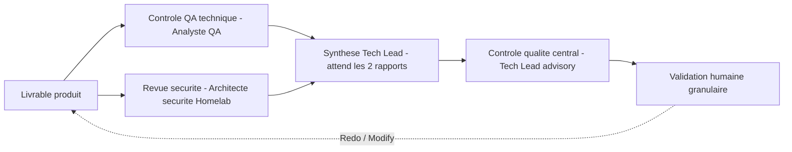

# Protocole — revue (reviewer) Homelab

Deux natures de revue coexistent dans le workflow Homelab, distinctes et non substituables. Miroir Homelab de [`core/common/protocols/reviewer.md`](../../../core/common/protocols/reviewer.md), adapté à l'équipe DevOps Homelab (pas d'Architecte cybersécurité dédié ; la sécurité technique est portée par l'**Analyste QA**, le jugement de posture par l'**Architecte de sécurité Homelab**).

## 1. Contrôle qualité central (Tech Lead — advisory)

Portée : aiguillage **GO / RENVOI** au niveau macro. Le Tech Lead vérifie uniquement : (a) le livrable répond-il à la demande et aux paramètres collectés ? (b) est-il du bon type et présent (fichier compose / `.tfvars` contenant les sections attendues, pas un rapport vide) ? (c) un secret en clair saute-t-il aux yeux ? (d) le compte-rendu du spécialiste signale-t-il un blocage ?

- **Jamais** la validité syntaxique, la compatibilité applicative, le hardening ou la cohérence Traefik : ces analyses appartiennent au Spécialiste Docker / Spécialiste Terraform (production / correctif) et à l'Analyste QA (vérification technique).
- **Ordre imposé** : tout livrable — **compose ET Terraform** — passe par l'Analyste QA **avant** l'aiguillage du Tech Lead.
- Doute technique → renvoyer au spécialiste en décrivant le **symptôme** observé (« l'authentification risque d'échouer »), **sans** fournir de diagnostic ni de solution.
- **Classe** `review_class: advisory`. Le contrôle qualité central **ne remplace jamais** le contrôle sécurité ni la validation humaine.

## 2. Contrôle sécurité (Analyste QA + Architecte de sécurité Homelab) — obligatoire, non substituable

Portée : sécurité de base d'un homelab (secrets, exposition réseau, permissions, durcissement Docker/Swarm, cohérence Traefik, absence de `${SNI}`). **Aucune notion de Loi 25 / PCI DSS / GDPR / LPRPDE.**

- **Analyste QA** — contrôle sécurité **technique** (revue adversariale) sur **les deux livrables** (docker-compose et configuration Terraform) : hardening, secrets `_FILE`, exposition, permissions, cohérence Traefik via `traefik-manager-read`, et côté Terraform structure HCL / cohérence des variables / absence de `${SNI}` (skill `terraform-qa`). **L'Analyste QA contrôle et classifie** (critical / warning / info) : tout défaut est consigné dans son rapport YAML (`verdict = RENVOI`, points autosuffisants) adressé **au Tech Lead**, jamais au spécialiste directement. Le Tech Lead attend aussi le rapport de la revue sécurité (parallèle), synthétise, puis délègue **un lot de correctifs par livrable** ; la QA et la sécurité re-contrôlent la version corrigée une seule fois.
- **Architecte de sécurité Homelab** — **jugement** de posture (voix adoptée / sollicité pour les décisions structurantes de sécurité et la couche `global` des règles).
- **Déclenché systématiquement** dès qu'un stage produit ou modifie une surface de sécurité (compose, Terraform, hardening, exposition, Traefik, secrets).
- Procédure : le Tech Lead poste un commentaire mentionnant l'Analyste QA (UUID résolu via `multica agent list --output json`) avec le contexte et le résumé des modifications ; **attend l'analyse** ; intègre les recommandations **avant** la validation humaine.
- **Plancher SG-3** : aucun contrôle qualité central, aucun gate / sensor advisory ne peut porter, remplacer, conditionner ni court-circuiter ce contrôle. Un « vert » de gate ne dispense jamais du contrôle sécurité.

## Articulation des deux revues et du gate humain

- Le contrôle qualité central **prépare** le gate humain ; il ne remplace ni la QA ni la revue sécurité.
- La **QA et la revue sécurité tournent en parallèle** sur la même version. Le Tech Lead **attend les deux rapports**, les synthétise, puis lance le contrôle qualité central : la **délégation sécurité** (Tech Lead → Architecte de sécurité Homelab, [`security-delegation.md`](../stages/production/security-delegation.md)) n'est plus placée après lui.
- L'ordre contrôle sécurité → validation humaine sur toute surface de sécurité est fixé par la règle normative unique : [`governance-security.md` § Contrôle sécurité systématique](governance-security.md#contrôle-sécurité-systématique).
- La **validation humaine granulaire** reste l'unique gate décisionnel contraignant (invariant) ; un constat sécurité critique / majeur déclenche un arrêt immédiat avec question à l'humain, **avant** la validation granulaire (voir [`security-delegation.md`](../stages/production/security-delegation.md) Step 3).

## Fin de revue

L'agent de revue notifie le Tech Lead par **mention valide** sur l'issue, **en attachant le compte-rendu YAML** (`review-<agent>-<stack>.yaml`) conforme au format unique [`report-format.md`](report-format.md) / [`report-format.schema.yaml`](report-format.schema.yaml). Ce geste vaut pour **chaque verdict — `OK` compris**. Corps minimal (mention valide + `verdict` + « rapport YAML en pièce jointe ») : aucune prose ni liste de points dans le thread. Sans mention valide, le compte-rendu est réputé **non rendu** et le flux s'arrête. Après publication, l'agent vérifie `trigger_outcomes` ; tant que le run de reprise du Tech Lead n'est pas enfilé, la revue reste **ouverte** (reprise unique de la mention, puis `blocked` + escalade humaine). **L'omission de la mention de retour est un défaut, jamais une clôture implicite.**
