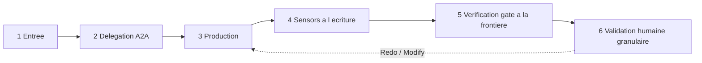

# Protocole — exécution générique d'un stage

Cycle standard qu'un stage suit, quelle que soit sa phase. Il ne se substitue jamais aux instructions propres de la fiche de stage ; il en fixe l'ossature commune, adaptée au moteur A2A Multica (mentions UUID, `trigger_outcomes`, statut d'issue, verrou metadata, piste d'audit sur l'issue).

Miroir Homelab de [`core/common/protocols/stage-protocol.md`](../../../core/common/protocols/stage-protocol.md).

## Cycle en 6 temps



### 1. Entrée — pré-requis et contexte

- Vérifier que les `requires_stage` sont satisfaits et que les artefacts `consumes` (marqués `required: true`) existent. Sinon : **halt-and-ask** (ne jamais deviner).
- Lire le verrou de concurrence `active_step` de la stack visée (un seul traitement par stack, lu **par artefact**) ; si un traitement est actif **sur le même artefact**, mettre en file et attendre la libération (deux artefacts disjoints — compose vs `.tfvars` — peuvent progresser en parallèle).
- Charger, **à la demande**, uniquement le contexte nécessaire au stage (chargement optimisé — voir [`conductor.md`](../conductor.md)).
- **À réception d'une délégation, le délégataire recharge sa fiche de stage (le *quoi* de son étape) et les protocoles qu'elle cite** — ceux listés dans le message A2A `delegation` —, rien d'autre. Chargement ciblé et paresseux ; ne pas relire le workflow en entier. Le champ `core_home` (= `$CORE_HOME`) évite de re-chercher le harnais (convention d'invocation : [`../../sensors/README.md`](../../sensors/README.md)).

### 2. Délégation A2A (si `mode: subagent | pipeline | mob`)

- Le Tech Lead poste un commentaire sur l'issue avec une **mention valide** `[@Label](mention://agent/<uuid>)` et le **nom d'un fichier YAML `delegation` joint** (message A2A — [`governance-security.md`](governance-security.md) § « Schéma du message A2A ») : **aucune prose de mission dans le fil**. Le YAML `delegation` (champs : même § « Schéma du message A2A ») permet au délégataire de lancer sensors/gates/hook et de charger son contexte **de façon ciblée**, sans re-chercher le harnais ni relire le workflow entier.
- **UUID et `trigger_outcomes`** : résolution de l'UUID, lecture de `trigger_outcomes` après chaque mention et statuts bloquants : [`governance-security.md`](governance-security.md) § « Règle A2A ». Procédure de résolution : [`tech-lead-homelab-agent.md`](../../agents/tech-lead-homelab-agent.md).
- La **topologie** dépend du `mode` :
  - `subagent` : hub-and-spoke ;
  - `pipeline` : supports chaînés dans l'ordre déclaré, chacun voyant tout le travail amont ;
  - `mob` : supports en parallèle contre le brouillon du lead ;
  - `pipeline` / `mob` exigent `support_agents` non vide.
  - ⚠️ Ne pas confondre avec les **stages de Production** : Docker et Terraform s'y exécutent **en parallèle** (deux sous-issues `--stage 1`, voir [« Cycle de statut des sous-issues & barrière de stage »](#cycle-de-statut-des-sous-issues--barrière-de-stage)), ce n'est pas un `pipeline` séquentiel.
- **Statut de la sous-issue déléguée** : `in_progress` au démarrage (`multica issue status <sous-issue-id> in_progress`). Cycle complet : [« Cycle de statut des sous-issues & barrière de stage »](#cycle-de-statut-des-sous-issues--barrière-de-stage).
- Si `mode: inline`, le Tech Lead exécute directement (supports = voix adoptées).
- Le spécialiste appelé **rend toujours compte** au Tech Lead en fin de tâche, par une **mention valide** de retour :
  - un compte-rendu sans mention valide est réputé non rendu et arrête le flux ;
  - le lien de retour actif est construit **par l'agent délégataire** (UUID résolu via `multica agent list --output json`), jamais recopié depuis la mission ;
  - l'assigneur ne pose jamais de lien actif vers lui-même (anti-wake parasite) : il nomme l'agent de retour **en texte clair** ;
  - voir [`governance-security.md`](governance-security.md) § « Règle A2A ».
- **Pas d'accusé de réception (tous agents).** À la réception d'un retour sans décision ni action, le Tech Lead ne commente pas la sous-issue ; un spécialiste ou reviewer réveillé sans nouvelle mission ne poste rien ([`governance-security.md`](governance-security.md) § « Règle A2A », « Pas d'accusé de réception »).
- **Reprise bornée puis escalade** : une seule reprise de mention, puis `blocked` + escalade humaine ([`governance-security.md`](governance-security.md) § « Règle A2A »).
- Si `for_each` est déclaré, le cycle 3→6 s'exécute **une fois par instance** de l'artefact nommé.

### 3. Production

- La fonction `lead_agent` produit les artefacts `produces`, dans la langue de l'humain, sans secret, avec les commentaires utiles des gabarits conservés.
- Chaque décision structurante est tracée dans le registre de décisions (`decisions/`).
- L'agent trace son avancement sur l'issue (piste d'audit au fil de l'eau) et dépose les livrables **téléchargeables** (`multica attachment upload`).
- **Statut de la sous-issue déléguée** : `in_review` dès le livrable produit et le compte-rendu rendu (`multica issue status <sous-issue-id> in_review`). Cycle complet : [« Cycle de statut des sous-issues & barrière de stage »](#cycle-de-statut-des-sous-issues--barrière-de-stage).

### 4. Sensors à l'écriture

> ⛔ **Les sensors ne se contournent pas.** Une vérification équivalente faite en prose, un commentaire ad hoc, ou une affirmation « conforme » sans exécution de `sensor.py` **ne satisfont pas** le temps 4. L'absence de verdict pour un sensor déclaré est un **écart à signaler** (SG-2 : `⛔ indisponible ≠ conforme`, silence = écart).

À l'écriture d'un artefact (compose, `.tfvars`), l'agent **auteur** :

- exécute **tous les sensors déclarés** dans le champ `sensors:` de la fiche de stage : `python3 "$CORE_HOME/homelab/scripts/sensor.py" --root <projet> fire <id> --path <artefact>` ;
  - sensors `fire_on: gate` : sans `--path`, au gate (temps 5) ;
  - le verdict est celui du script, jamais réinterprété ;
- collecte chaque verdict dans `sensors_resultats` du message A2A `retour` joint en fin de mission ([`governance-security.md`](governance-security.md) § « Schéma du message A2A ») : **un élément par sensor déclaré**, structuré ainsi :

```yaml
sensors_resultats:
  - {sensor: <id>, fire_on: write | gate, verdict: conforme | ecart | indisponible, detail: "<ligne factuelle>", source: "<manifeste @ commit>"}
```

Les verdicts voyagent dans ce **YAML joint** (le reviewer les porte dans le champ `sensors[]` de son rapport `review-<agent>-<stack>.yaml`, [`report-format.md`](report-format.md)), **pas** en prose dans le fil de commentaires.

> **Où se lance un sensor (convention d'invocation).**
>
> - Le harnais (`homelab/scripts/sensor.py`, manifestes `homelab/sensors/`, hook `homelab/sensors/hooks/post_write.py`) vit dans le **checkout `homelab-portfolio`**, jamais dans le dépôt du projet vérifié.
> - Les sensors se lancent **depuis ce checkout** : chemin **ancré** sur `$CORE_HOME` (racine du checkout), et `--root <projet>` pointe le dépôt à vérifier.
> - Un chemin **relatif** (`homelab/scripts/sensor.py`) ne se résout que si le répertoire courant est ce checkout.
> - Détail et exemples : [`../../sensors/README.md`](../../sensors/README.md).

Règles non contournables :

- **Chaque sensor déclaré fait l'objet d'une entrée distincte dans `sensors_resultats`** — aucun regroupement ni omission (SG-2 : silence = écart).
- **`⛔ indisponible`** s'applique lorsque le script ne peut pas s'exécuter (Python absent, erreur, périmètre vide — voir [`../../sensors/README.md`](../../sensors/README.md)) : l'agent reprend le motif donné par le script et le reporte avec ce verdict. Un sensor non exécuté est toujours un verdict `indisponible`, **jamais un silence** ni une vérification en prose.
- **`⚠️ écart`** : l'agent décrit l'écart en une ligne et continue (advisory) ; il **ne devance pas** la décision humaine mais la documente pour la validation humaine granulaire (temps 6).
- **Advisory par défaut** — n'autorise aucun raccourci, ne vaut pas validation (SG-1..6). **Exception** : `plaintext-secret` / `terraform-no-sni` sont **bloquants sur `security-patch` / `new-stack`** (ALI-204) — une détection arrête l'avancée jusqu'à correction ou levée humaine explicite tracée.
- Les sensors `fire_on: write` (ex. `yaml-validity`, `plaintext-secret`, `terraform-no-sni`) sont invoqués **à chaque écriture** de l'artefact concerné, pas seulement en fin de stage.

Ce rapport par sensor est **repris en synthèse** dans `sensors_resultats` du message A2A `retour` à la fin de mission ([`governance-security.md`](governance-security.md) § « Schéma du message A2A ») :

- **reviewer** : rapport `review-<agent>-<stack>.yaml`, champ `sensors[]` ([`report-format.md`](report-format.md)) ;
- **producteur** : YAML `retour-<agent>-<stack>.yaml` ([`producer-report.md`](producer-report.md)) ;
- le fil de commentaires ne porte plus ces verdicts en prose : ils voyagent dans le YAML joint, exploitables pour les contrôles et le gate humain.

### 5. Verification gate à la frontière de phase

> ⛔ **Le rapport de gate ne se contourne pas.** Le Tech Lead **poste le « Rapport de vérification »** ([`homelab/sensors/gates.md`](../../sensors/gates.md)) *avant* la validation humaine, avec `python3 "$CORE_HOME/homelab/scripts/sensor.py" --root <projet> gate <frontière>` (lancé depuis le checkout `homelab-portfolio` — voir la convention d'invocation du temps 4). L'absence de rapport est un écart de piste d'audit.

- À la sortie de la phase, le Tech Lead exécute le gate de traçabilité et poste le **« Rapport de vérification »** structuré pour la frontière franchie — checks `artefacts-presents` / `liaison-tracabilite` / `absence-orphelin` **et** la ligne **par sensor de gate** déclaré à cette frontière (verdict `✅` / `⚠️` / `⛔` + fait ou motif), selon le format fixé par [`homelab/sensors/gates.md`](../../sensors/gates.md) § « Rapport de gate ».
- Un écart est signalé, jamais bloquant (advisory) — **sauf** l'exception bloquante par scope (`livrable_tfvars_present` sur `new-stack` / `infra-terraform`, cf. `gates.md`) ; `⛔ indisponible ≠ conforme` (SG-2). **Chaque sensor de gate déclaré figure dans le rapport** — aucune omission.

### 6. Validation humaine granulaire

- Selon `human_gate` : `none` (aucune — Initialisation), `light` (approbation intention/périmètre — Idéation), `granular` (choix par choix — Cadrage / Production), `explicit` (validation explicite + prérequis §4.0 + rollback si destructif — Validation).
- Boucle **Keep / Modify / Redo** par élément (voir [`../conductor.md`](../conductor.md)). Sur `Modify` / `Redo`, retour au temps 3 pour l'élément concerné uniquement.

## Cycle de statut des sous-issues & barrière de stage

Quand un stage délègue son travail via des **sous-issues** (cas des stages de Production parallèles — Docker ∥ Terraform, deux sous-issues `--stage 1`), le statut de **chaque sous-issue spécialiste** suit un cycle en trois temps, et c'est l'atteinte de `done` sur **toutes** les sous-issues qui lève la **barrière de stage** vers l'aiguillage central.

1. **`in_progress`** : début du travail, à l'ouverture de la sous-issue (délégation A2A, temps 2).
2. **`in_review`** : livrable produit et compte-rendu rendu (temps 3). Le livrable attend sa vérification QA.
3. **`done`** : l'Analyste QA **et** l'Architecte de sécurité Homelab ont rendu `OK` sur le livrable. Le Tech Lead passe la sous-issue correspondante à `done` (`multica issue status <sous-issue-id> done`).
   - Correspondance un-pour-un : livrable Docker validé → sous-issue Docker `done` ; livrable Terraform validé → sous-issue Terraform `done`.
   - Un `RENVOI` (QA ou sécurité) laisse la sous-issue en `in_review` jusqu'à `OK` des deux contrôles sur la version corrigée.

> `done` est ici le signal d'**acceptation technique du livrable par la QA et la revue sécurité** au sein du flux, et non la clôture humaine de l'issue parente — celle-ci reste la décision humaine portée par [`stages/validation/closure.md`](../stages/validation/closure.md).

**Barrière de stage.** L'aiguillage central ([`stages/production/central-quality-control.md`](../stages/production/central-quality-control.md)) ne démarre que lorsque **toutes** les sous-issues spécialistes du stage sont à `done`.

- Pas de démarrage tant que Docker **et** Terraform ne sont pas `done`.
- Une sous-issue en `in_review` (ou en attente de re-contrôle après `RENVOI`) : barrière non franchie.
- Condition : « toutes les sous-issues `done` », jamais « au moins un livrable en `in_review` ».

## Contrôle sécurité — non contournable

Dès qu'un stage **produit ou modifie une surface de sécurité** (compose, Terraform, hardening, exposition, Traefik, secrets), le contrôle sécurité s'applique selon la **règle normative unique** [`governance-security.md` § Contrôle sécurité systématique](governance-security.md#contrôle-sécurité-systématique) (répartition des rôles Analyste QA technique / Architecte de sécurité Homelab posture : même source et [`reviewer.md`](reviewer.md)). Point propre à l'exécution : l'autonomie (Production) ne le court-circuite ni ne le diffère jamais.

## Halt-and-ask

Le cycle s'arrête et interroge l'humain dès : échec / impossibilité d'un livrable ; écart ou contrôle de sécurité requis ; gate / sensor en écart, bloquant, ou `⛔ indisponible` ; décision structurante nouvelle non cadrée ; action à impact / destructive (dépôt de fichiers, flux Kestra, application n8n / Home Assistant) — **jamais autonome**, elle relève de la Validation sous validation explicite.
