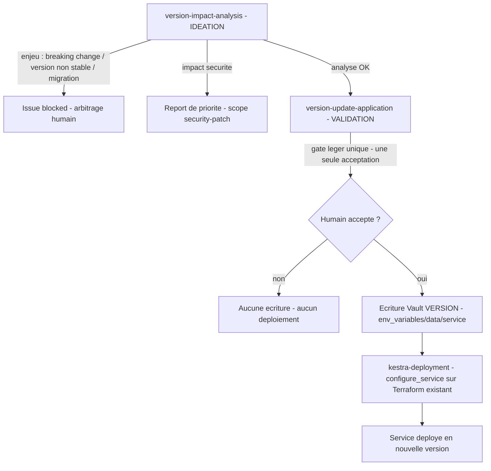

# Scope `service-version-update`

Mise à jour d'un **service existant** (stack Docker Swarm ou service Proxmox) vers une **nouvelle
version disponible** — montée de version d'image, bump déclenché par une release amont. Le point
d'entrée et le standard d'analyse d'impact de ce parcours sont tracés en
[`decisions/0044`](../../decisions/0044-parcours-service-version-update-gate-leger-unique-ecriture-vault-version.md).

C'est une **spécialisation ciblée** de `stack-update` : là où `stack-update` couvre toute
modification structurante d'une stack existante, `service-version-update` couvre le cas précis
« un service tourne déjà, une nouvelle version est sortie, on veut y passer ». Il porte un parcours
en **trois temps** :

1. **Analyse d'impact de version** — type de service (Docker Swarm vs Proxmox), lecture de la
   version actuelle dans Vault (clé `VERSION`, lecture seule), analyse de la page Release GitHub,
   détection des breaking changes et des enjeux de configuration. Un enjeu détecté (breaking
   change, version non stable, migration de configuration) **bloque** le parcours : l'issue passe
   `blocked`, aucune suite n'est engagée sans arbitrage humain.
2. **Écriture `VERSION` dans Vault** — mise à jour de la seule clé `VERSION` du montage
   `env_variables/data/<service>` via la skill `homelab-vault-access` (exception d'écriture
   étroite, voir ci-dessous).
3. **Déploiement Kestra** — lancement du flux `configure_service` à partir du fichier Terraform du
   service (`terraform/swarm/<service>` pour Docker Swarm, `terraform/services/<service>` pour
   Proxmox).

## Gate humain léger unique

Après une analyse d'impact **OK** (aucun breaking change, aucun enjeu de configuration), un **seul**
point de validation **léger** gouverne les temps 2 et 3. Sur acceptation, l'écriture Vault de
`VERSION` **et** le déploiement Kestra sont **tous deux autorisés en une seule étape** — pas
d'aller-retour, pas de double validation. Ce gate `light` est porté par le stage
[`version-update-application`](../common/stages/validation/version-update-application.md) ; il reste
**non supprimable** (aucune action à impact n'est autonome — invariant du conductor).

## Exception d'écriture Vault étroite

La skill `homelab-vault-access` reste en **lecture seule** pour tous les autres parcours. Ce scope
est le **seul** cas d'écriture autorisé, et uniquement pour écrire la clé `VERSION` du montage
`env_variables/data/<service>`. **Jamais** un secret du montage `services/`, jamais une autre clé.
L'écriture suit un pattern read-modify-write qui préserve toutes les autres clés ; la valeur
n'est **jamais** affichée, loggée ni transmise ; l'écriture est tracée sur l'issue (nom de clé
`VERSION` + statut seulement). Détail : [`homelab-vault-access`](../../plugins/homelab-assistant/skills/homelab-vault-access/SKILL.md).

## Report de priorité — `security-patch` l'emporte

Si la montée de version a un **impact sécurité** (correctif de CVE, durcissement, changement
d'authentification / d'exposition / de secrets), `security-patch` **l'emporte** sur ce scope dans
l'ordre de désambiguïsation : le plancher `comprehensive` / `renforcé` et les sensors sécurité
bloquants s'appliquent alors. `service-version-update` ne vaut que pour une montée de version
**sans** enjeu sécurité propre.

Axes par défaut : Depth `standard`, vérification `standard` (analyse d'impact de version,
cohérence du déploiement). Overridable à la hausse à la confirmation de scope — jamais abaissable
sans trace.

Appartenance : voir la matrice scope × phase de
[`../common/protocols/scopes-and-axes.md`](../common/protocols/scopes-and-axes.md) et le champ `scopes:`
des fiches de stage ([`../common/stages/`](../common/stages/)).
